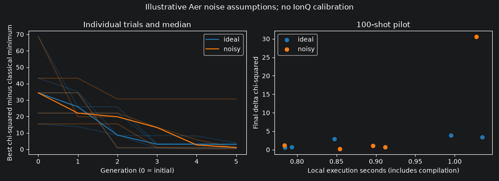

# Local 100-shot noise pilot

The checkout had no IonQ noise demo. `scripts/ionq_noise_demo.py` now runs the
maintained AEQGA pipeline through `IonQDemoExecutor`, using local Aer density
matrix simulation. Notebook section 13 records the executed experiment, plot
and interpretation. Existing scientific settings and historical outputs remain
available independently of this short pilot.

## Model and scope

The default assumptions are depolarizing channel strengths of 0.001 on RX/RY/RZ,
0.01 on RXX, and independent symmetric readout bit flips with probability 0.005.
These strengths are not average gate infidelities. They are illustrative choices,
not IonQ calibration data. Construct `IonQDemoNoise(one_qubit=..., two_qubit=...,
readout=...)` and pass it to `run_demo(noise=...)` to change them explicitly.

The all-to-all rotation/XX basis is inspired by trapped-ion interactions, but
does not implement IonQ native pulse compilation. The model excludes coherent
errors, crosstalk, drift, timing effects and reset errors. Both experiment arms
use reset-free `state_preparation`. This pilot adapter has no persistent restart
support; its complete counts and compilation diagnostics are exported afterwards.

IonQ's own hosted simulator is a separate implementation with device noise
models. See [IonQ's noise simulation guide](https://ionq.com/resources/get-started-with-hardware-noise-model-simulation).
This local approximation does not claim to reproduce its results.

## Reproduce

Use the project environment and real Pantheon+ data described in the README:

```bash
OMP_NUM_THREADS=1 OPENBLAS_NUM_THREADS=1 MPLBACKEND=Agg \
  python -m scripts.ionq_noise_demo --shots 100 --generations 5 --runs 5
python -m unittest tests.test_ionq_noise -v
```

Alternatively, execute section 13 of `notebooks/AEQGA.ipynb` directly. It is
self-contained and does not rerun the preceding 300-run production ensemble.
The demo uses seeds 23–27, 32 individuals, crossover/mutation probabilities 0.5,
and the real calibrated Pantheon+ full-covariance objective with distance grid
300. Each ideal/noisy pair starts with the same seed and population. After counts
change, their later populations and circuits can differ. Fixed-circuit probes
separately isolate the channel's distribution effect.

## Recorded results

These are short integration trials, not convergence or hardware benchmarks.

| Metric | Ideal finite-shot | Noisy finite-shot |
|---|---:|---:|
| Shots per circuit | 100 | 100 |
| Independent seeds | 5 | 5 |
| Updates per trial | 5 | 5 |
| Median local trial seconds | 0.848 | 0.896 |
| Median final delta chi-squared | 2.9179 | 1.0868 |
| Largest final delta chi-squared | 3.8642 | 30.6155 |

The configured classical minimum is chi-squared 1752.9040 at
[H0, Omega_m] = [72.83204, 0.362876]. The noisy median is lower, but its poor
seed-23 outcome is retained. Five short trials cannot establish a benefit or a
robustness penalty from noise. Local timing includes transpilation and execution;
the measured median overhead is about 6%, which is machine- and workload-dependent.
Total demo wall time, including setup and probes but excluding plotting, was
12.617 seconds in the recorded notebook kernel.

Compilation probability error was below 3e-14. Exact model-induced TVD was
0.02179 for the 3-qubit probe and 0.08071 for the 4-qubit probe. Finite-shot
sampling TVD was approximately 0.08–0.10. Exact density-matrix probabilities
and an analytically applied readout channel distinguish modeled noise from
sampling fluctuations that can obscure it at 100 shots.

The workload was 200 optimizer circuits plus four sampled probes, totaling
20,400 circuit-shots. Two extra exact density-matrix probes do not sample shots.
The optimizer evaluated the classical objective 1,920 times, excluding setup,
classical reference and verification evaluations. No cloud jobs ran: cloud service
charges were $0. CPU/electricity costs are unpriced. This supplies no estimate of
real QPU runtime or billing.

## Evidence and validation

- [Executed notebook](../notebooks/AEQGA.ipynb)
- [Numeric results, raw counts, settings and source/data provenance](../outputs/json/ionq_noise_demo.json)
- [PNG figure](../outputs/png/ionq_noise_demo.png), [SVG](../outputs/svg/ionq_noise_demo.svg), [PDF](../outputs/pdf/ionq_noise_demo.pdf)



The five noise unit tests cover exact depolarizing effects, deterministic readout
flips and bit ordering, zero-noise equivalence, shot totals, invalid input and
nonzero distribution effects. Each scientific trial checks bounded finite
populations, monotonic best fitness, objective consistency and circuit widths
[4, 3, 4, 3]. Integer count totals are checked by the existing executor.

The notebook layout regression now permits saved executed outputs and rejects
saved execution errors, matching the team's GitHub presentation requirement.
