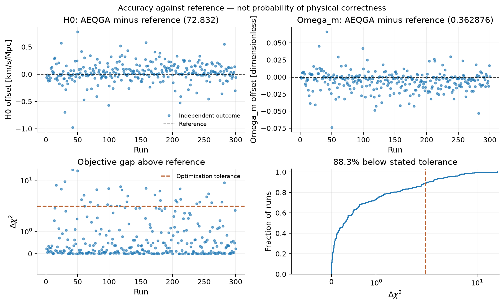

# Pantheon+ plots and 300-run results

These figures were generated on 2026-10-23 using the calibrated Pantheon+
MU_SH0ES measurements and full STAT+SYS covariance, retaining all 1701 rows.
The experiment uses 300 independent finite-shot circuit simulations, each with
32 individuals, 50 updates, 4096 shots per circuit and crossover/mutation
probabilities of 0.5. The execution engine is `statevector_shots`.

## Plots

| Figure | PNG preview | Vector exports |
|---|---|---|
| Accuracy against the classical fit | [PNG](../outputs/png/sne_production_notebook_accuracy.png) | [SVG](../outputs/svg/sne_production_notebook_accuracy.svg), [PDF](../outputs/pdf/sne_production_notebook_accuracy.pdf) |
| Single-run convergence and best-pair histories | [PNG](../outputs/png/notebook_sne_diagnostics.png) | [SVG](../outputs/svg/notebook_sne_diagnostics.svg), [PDF](../outputs/pdf/notebook_sne_diagnostics.pdf) |
| Joint likelihood contours | [PNG](../outputs/png/notebook_sne_likelihood.png) | [SVG](../outputs/svg/notebook_sne_likelihood.svg), [PDF](../outputs/pdf/notebook_sne_likelihood.pdf) |
| Optimizer scatter | [PNG](../outputs/png/notebook_sne_optimizer_scatter.png) | [SVG](../outputs/svg/notebook_sne_optimizer_scatter.svg), [PDF](../outputs/pdf/notebook_sne_optimizer_scatter.pdf) |
| Optimizer density | [PNG](../outputs/png/notebook_sne_optimizer_density.png) | [SVG](../outputs/svg/notebook_sne_optimizer_density.svg), [PDF](../outputs/pdf/notebook_sne_optimizer_density.pdf) |
| Likelihood and optimizer overlay | [PNG](../outputs/png/notebook_sne_optimizer_overlay.png) | [SVG](../outputs/svg/notebook_sne_optimizer_overlay.svg), [PDF](../outputs/pdf/notebook_sne_optimizer_overlay.pdf) |

## Agreement with the classical fit

| Quantity | H0 [km/s/Mpc] | Omega_m |
|---|---:|---:|
| Configured classical reference | 72.832041 | 0.362876 |
| Mean of 300 AEQGA outcomes | 72.864542 | 0.356890 |
| Signed mean offset | +0.032501 | -0.005987 |
| Mean absolute error | 0.127556 | 0.011008 |
| Root mean squared error | 0.188567 | 0.015855 |
| Mean absolute percentage error | 0.1751% | 3.0337% |

The configured classical minimum is chi-squared **1752.904047**. Across the
300 outcomes, the median optimization gap is **0.292705**, the 90th percentile
is **2.419300**, and the largest gap is **17.977723**. All outcomes, including
poor fits, are retained in the accuracy plot and numeric report.

**265/300 runs (88.3%)** have delta chi-squared < 2.30. The 95% Wilson interval
for that independent-run success fraction is **84.2–91.5%**. This is an optimizer
success-rate interval, not confidence that the cosmological parameters are true.

Re-evaluating the same returned points with direct distances gives classical
reference [72.837349, 0.362369], minimum chi-squared **1752.903310**, median gap
**0.305325**, and mean absolute percentage errors of **0.1740%** for H0 and
**2.9835%** for Omega_m. The fraction below delta chi-squared 2.30 remains 265/300.
The direct comparison does not polish or replace the optimizer outcomes.

The separate, preselected single trajectory has best [H0, Omega_m] approximately
[72.909151, 0.351115], chi-squared **1753.408165**, and gap **0.504118**.
Its 51 recorded best-pair objective values were re-evaluated with zero discrepancy.

## Numeric results and figure provenance

- [Configured/direct accuracy report](../outputs/json/sne_production_notebook_accuracy.json):
  per-run estimates, errors, chi-squared gaps, aggregate statistics and experiment identity.
- [Single-run results](../outputs/json/notebook_sne_results.json): trajectory and configuration.
- Each figure has a matching `*_figure_provenance.json` in `outputs/json/`,
  recording experiment information and hashes of its PNG/SVG/PDF exports.

Ensemble fingerprint:
`148ce0631cd400fb5dc6aa6b9bd0ccf9d821bf8691dd2afa732db2040e70774e`.
The full population checkpoint files and downloaded data remain local; the
accuracy report and figure sidecars retain the settings, independent seeds,
versions and data/source hashes needed to identify this experiment.

Likelihood contours describe the configured model/data. Scatter and density
regions describe optimizer outcomes. Agreement with a classical fitted reference
does not establish the true cosmological value. These are finite-shot simulation
results; they do not measure device noise. See [graph interpretation](GRAPH_ACCURACY.md).
