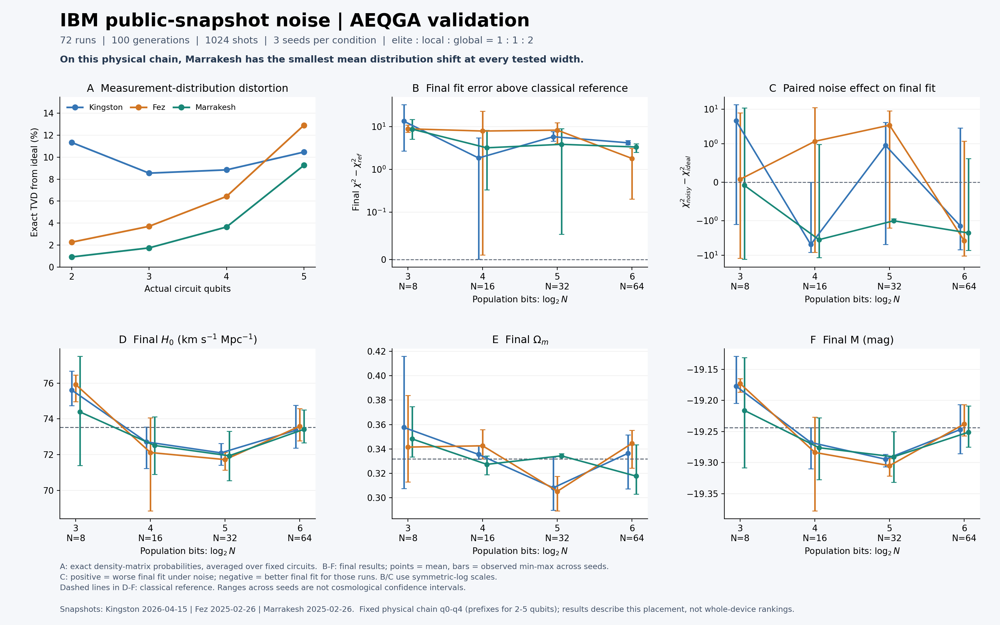
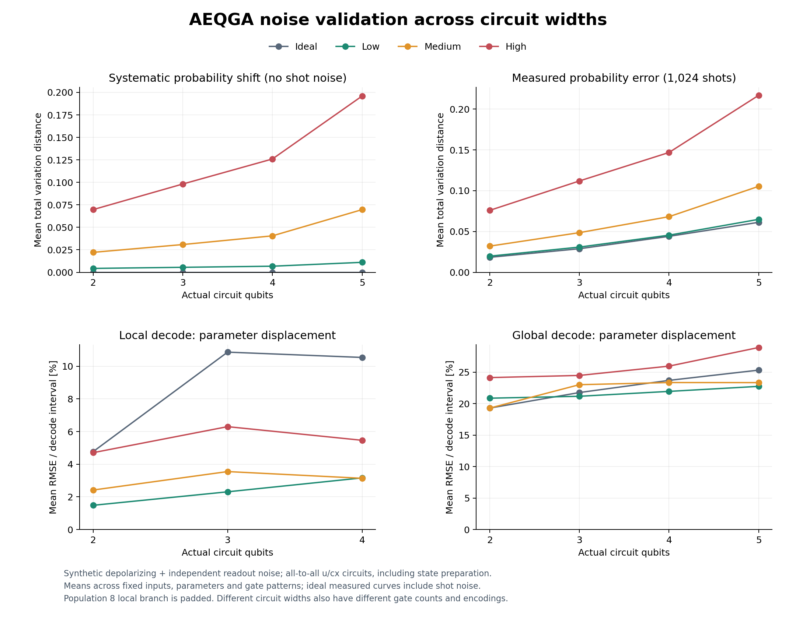

# Noise validation and complete archived results

This directory contains a standalone AEQGA noise-validation workflow, its input
data, calibration snapshots, complete historical training records and figures.
The top-level Python files are the current runtime. The `results/` directory
contains the previously completed experiments and their historical reproduction
sources. Collection date: 2026-10-16.

[Download the complete ZIP](../noise_validation_bundle.zip), with its
[SHA-256 checksum](../noise_validation_bundle.zip.sha256).

## Contents

| Path | Contents |
| --- | --- |
| `run_noise_validation.py`, `aeqga_noise.py` | Synthetic depolarizing and readout-noise validation |
| `run_ibm_noise_validation.py`, `aeqga_ibm_noise.py` | Kingston, Fez and Marrakesh snapshot validation |
| `aeqga.py`, `aeqga_parallel.py` | Required optimizer and circuit-packing implementation |
| `run_pantheon_aeqga.py` | Shared data loader, cosmology objective and numerical checks |
| `test_*.py` | Optimizer, plotting, noise, compilation and parallel-circuit tests |
| `Pantheon+_Data/4_DISTANCES_AND_COVAR/` | Required Pantheon+SH0ES table, STAT+SYS covariance and upstream README |
| `ibm_backend_snapshots/` | Unmodified public calibration JSON, source provenance and Apache-2.0 license |
| `results/qubit_noise_validation/` | Complete synthetic-noise results and historical reproduction sources |
| `results/ibm_device_noise_validation/` | Complete 72-run IBM results, measured counts, QPY circuits and original reproduction snapshot |
| `verification/` | Delivery-time test logs and separate one-generation smoke checks |
| `collection_provenance.json`, `SHA256SUMS.txt` | Source/version provenance and file-integrity manifest |

## Environment and current run commands

Use Python 3.11 and the pinned requirements in this directory. Run the following
from the repository root. Use a separate environment for this workflow: the root
project has different dependency requirements and a separate `aeqga` package.

Windows PowerShell:

```powershell
cd noise_validation
py -3.11 -m venv .venv
.\.venv\Scripts\python.exe -m pip install -r requirements.txt
.\.venv\Scripts\python.exe -m unittest -v test_aeqga test_history_plot test_noise_validation test_ibm_noise_validation test_parallel_circuits
.\.venv\Scripts\python.exe verify_bundle.py

# Full synthetic-noise experiment
.\.venv\Scripts\python.exe run_noise_validation.py --output output/synthetic

# Full IBM snapshot experiment
.\.venv\Scripts\python.exe run_ibm_noise_validation.py --output output/ibm
```

Linux/macOS:

```bash
cd noise_validation
python3.11 -m venv .venv
.venv/bin/python -m pip install -r requirements.txt
.venv/bin/python -m unittest -v test_aeqga test_history_plot test_noise_validation test_ibm_noise_validation test_parallel_circuits
.venv/bin/python verify_bundle.py
.venv/bin/python run_noise_validation.py --output output/synthetic
.venv/bin/python run_ibm_noise_validation.py --output output/ibm
```

For a short end-to-end check, add these options to either experiment command:

```text
--generations 1 --shots 32 --seeds 7 --input-repeats 1 --sample-repeats 1
```

The IBM runner also accepts `--workers 1`. Full defaults are 100 generations,
1024 shots, seeds 7/17/27, three fixed-input variants and five fixed-circuit
sampling repeats. The IBM experiment runs both ideal and noisy modes on each of
the three devices and four populations: 72 training runs. The synthetic
experiment trains ideal/medium/high profiles: 36 runs. Fixed-circuit tests cover
all six synthetic noise profiles.

Runs write new outputs under `output/`; the bundled historical results stay
under `results/`. Both runners export per-generation candidates, all fitted
parameters and chi-squared values. The IBM runner also exports raw measurement
counts and an output ZIP containing its reproduction sources.

## Archived results and exact historical sources

The previous long experiments were not rerun for this upload. Their original
result files, numerical reports and source-version records are preserved.
The current top-level runtime includes later parallel-circuit support; use the
historical sources below to reproduce the archived versions.

For the archived IBM experiment, change into
`results/ibm_device_noise_validation/reproduction/`, install its
`requirements.txt` in a separate Python 3.11 environment, and run:

```bash
python run_ibm_noise_validation.py --output output/reproduced
```

For the archived synthetic experiment, change into
`results/qubit_noise_validation/reproduction/`, install its
`requirements.txt` in a separate Python 3.11 environment, and run:

```bash
python run_noise_validation.py --output output/reproduced
```

The synthetic reproduction sources were assembled from matching archived
AEQGA/noise files and the unchanged synthetic runner. All three Python hashes
and both input-data hashes match the original synthetic `summary.json`.
The complete original IBM `SHA256SUMS.txt` is also preserved and verified.

## Figures and training records

The overview plots below summarize the previously completed experiments.





The two `results/*/training_runs/` directories contain all recorded candidates
and chi-squared values. IBM records additionally include the quantum measurement
histograms. See `validation_report.txt` and `noise_validation_report.txt` in the
respective result directories for methods, settings and numerical summaries.

## Objective, circuit widths and noise-model scope

This standalone experiment fits three parameters: H0, Omega_m and the common
standardized absolute magnitude M. It selects 1657 of the 1701 Pantheon+SH0ES
rows, including 77 calibrators, and uses the full selected STAT+SYS covariance
after averaging its tiny numerical asymmetry. This is its own three-parameter
objective; numerical results must be interpreted using these data and settings
rather than the root package's separate calibrated-distance-modulus workflow.

Populations 8/16/32/64 have elite/local/global proportions 1:1:2. Their
population bit counts are 3/4/5/6, while the actual local/global circuit widths
are respectively 2/2, 2/3, 3/4 and 4/5 qubits. Circuit inputs, gate resources and
branch composition also change across populations; the comparison does not
isolate qubit count as the only changing variable.

IBM calibration JSON comes from `qiskit-ibm-runtime==0.50.0`. Archived experiments
use physical qubits 0-4, not the entire 156-qubit processors. Snapshot dates are:

| Device | Calibration timestamp |
| --- | --- |
| Kingston | 2026-04-15T09:15:15+02:00 |
| Fez | 2025-02-26T15:16:25-05:00 |
| Marrakesh | 2025-02-26T14:52:45-05:00 |

The simulator uses native-gate compilation, calibrated gate/readout errors and
scheduled thermal relaxation, including modeled idle time. It does not model
crosstalk, leakage, calibration drift or all correlated/coherent errors.
These are local Qiskit Aer simulations with archived calibration snapshots;
running them requires no IBM credentials and submits no quantum-hardware jobs.

Synthetic profiles are explicitly assumed noise channels, not ion-trap or
superconducting hardware calibrations. Seeds and repeated runs quantify the
stated simulations' sampling/optimization variability; optimizer scatter is
not a cosmological posterior confidence interval.

## Data and calibration provenance

The included Pantheon+ inputs retain the upstream README. Calibration provenance
and the calibration distribution's license are in `ibm_backend_snapshots/`.
Run `python verify_bundle.py` to check this delivery's manifest, the original IBM
manifest, and the synthetic experiment's recorded source/input hashes. Checksums
are byte-sensitive; `.gitattributes` preserves the bundled files' original bytes
across Git checkouts.
